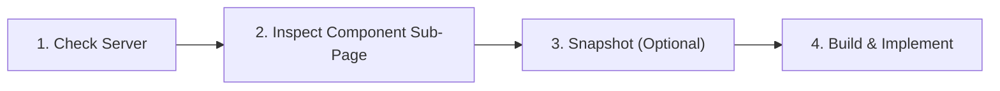

# Cloudscape Component Catalogue — Agent Reference Guide

> **Purpose for AI Agents & Pair Programmers**: Use this guide to quickly locate any Cloudscape component, inspect its live visual rendering in the browser, optionally capture snapshots to verify visual layout, and retrieve the exact code syntax to build UI features.

## Table of Contents

1. [Agent Workflow: Check Catalogue -> Snapshot -> Build](#agent-workflow)
2. [Server Configuration](#server-configuration)
3. [Integration Methods (3 Ways to Build)](#integration-methods)
4. [113 Components Index by Category](#113-components-index)
   - [Actions & Buttons (6)](#actions-buttons)
   - [Status & Feedback (11)](#status-feedback)
   - [Forms & Inputs (21)](#forms-inputs)
   - [File Uploading (5)](#file-uploading)
   - [Generative AI (4)](#generative-ai)
   - [Containers & Layout (17)](#containers-layout)
   - [Data Display & Tables (14)](#data-display-tables)
   - [Charts & Visualizations (9)](#charts-visualizations)
   - [Navigation (10)](#navigation)
   - [Board & Drag-and-Drop (4)](#board-drag-and-drop)
   - [Utilities & Content (12)](#utilities-content)

---

## Agent Workflow

When prompted: **"check the catalogue for X component"**, follow this standard 4-step execution flow:



### Step 1: Ensure Server is Live
- Check if `http://127.0.0.1:5001/` is reachable: `curl -s -o /dev/null -w "%{http_code}" http://127.0.0.1:5001/`
- If not running, start it daemonized: `PYTHONPATH=. python3 flask_cloudscape/__init__.py`

### Step 2: Query Component Sub-Page
- Find the component slug in the index below.
- Dedicated sub-page URL format: `http://127.0.0.1:5001/components/<slug>`
- Examples:
  - Table: `http://127.0.0.1:5001/components/table`
  - Bar Chart: `http://127.0.0.1:5001/components/bar-chart`
  - Cards: `http://127.0.0.1:5001/components/cards`
  - Tabs: `http://127.0.0.1:5001/components/tabs`
- Inspect the live DOM and required JSON attributes (`items`, `columnDefinitions`, `series`, etc.).

### Step 3: Capture Snapshot (Optional)
- If testing complex responsive layouts, charts, or tables, launch a browser task to inspect or capture a visual screenshot:
  - URL: `http://127.0.0.1:5001/components/<slug>`
- Verify font styling, margin spacing, and interaction states.

### Step 4: Build Code
Pick the best method for your template or view and drop it into your codebase.

---

## Server Configuration

- **Host / Port**: `http://127.0.0.1:5001`
- **Main Overview**: [http://127.0.0.1:5001/](http://127.0.0.1:5001/)
- **Sub-Page Root**: `http://127.0.0.1:5001/components/<slug>`
- **CSS Bundle**: `/cloudscape/static/css/cloudscape-adapter.css`
- **JS Bundle**: `/cloudscape/static/js/cloudscape-adapter.js`

---

## Integration Methods

### Method A: Jinja Macros (Recommended for Flask Templates)
```jinja

{{ cs_alert(type="success", header="Done", children="Deployed successfully") }}
{{ cs_button(variant="primary", text="Confirm") }}
```

### Method B: Web Component Tags (Direct HTML)
```html
<cloudscape-table
  header="Resources"
  items='[{"id": "1", "name": "prod-node"}]'
  column-definitions='[{"id": "name", "header": "Node Name"}]'>
</cloudscape-table>
```

### Method C: Python Component Classes (Backend Dynamic Rendering)
```python
from flask_cloudscape.components import Table, Button, Alert

btn = Button(variant="primary", text="Launch Instance")
return render_template("view.html", btn_html=btn.render())
```

---

## 113 Components Index


### Actions & Buttons

| Component Title | Slug | Sub-Page URL | Python Class | Web Component Tag | AWS Docs |
| :--- | :--- | :--- | :--- | :--- | :--- |
| **Button** | `button` | [`/components/button`](http://127.0.0.1:5001/components/button) | `Button` | `<cloudscape-button>` | [AWS Spec](https://cloudscape.design/components/button/) |
| **Button dropdown** | `button-dropdown` | [`/components/button-dropdown`](http://127.0.0.1:5001/components/button-dropdown) | `ButtonDropdown` | `<cloudscape-button-dropdown>` | [AWS Spec](https://cloudscape.design/components/button-dropdown/) |
| **Button group** | `button-group` | [`/components/button-group`](http://127.0.0.1:5001/components/button-group) | `ButtonGroup` | `<cloudscape-button-group>` | [AWS Spec](https://cloudscape.design/components/button-group/) |
| **Toggle button** | `toggle-button` | [`/components/toggle-button`](http://127.0.0.1:5001/components/toggle-button) | `ToggleButton` | `<cloudscape-toggle-button>` | [AWS Spec](https://cloudscape.design/components/toggle-button/) |
| **Segmented control** | `segmented-control` | [`/components/segmented-control`](http://127.0.0.1:5001/components/segmented-control) | `SegmentedControl` | `<cloudscape-segmented-control>` | [AWS Spec](https://cloudscape.design/components/segmented-control/) |
| **Copy to clipboard** | `copy-to-clipboard` | [`/components/copy-to-clipboard`](http://127.0.0.1:5001/components/copy-to-clipboard) | `CopyToClipboard` | `<cloudscape-copy-to-clipboard>` | [AWS Spec](https://cloudscape.design/components/copy-to-clipboard/) |

### Status & Feedback

| Component Title | Slug | Sub-Page URL | Python Class | Web Component Tag | AWS Docs |
| :--- | :--- | :--- | :--- | :--- | :--- |
| **Alert** | `alert` | [`/components/alert`](http://127.0.0.1:5001/components/alert) | `Alert` | `<cloudscape-alert>` | [AWS Spec](https://cloudscape.design/components/alert/) |
| **Badge** | `badge` | [`/components/badge`](http://127.0.0.1:5001/components/badge) | `Badge` | `<cloudscape-badge>` | [AWS Spec](https://cloudscape.design/components/badge/) |
| **Status indicator** | `status-indicator` | [`/components/status-indicator`](http://127.0.0.1:5001/components/status-indicator) | `StatusIndicator` | `<cloudscape-status-indicator>` | [AWS Spec](https://cloudscape.design/components/status-indicator/) |
| **Flashbar** | `flashbar` | [`/components/flashbar`](http://127.0.0.1:5001/components/flashbar) | `Flashbar` | `<cloudscape-flashbar>` | [AWS Spec](https://cloudscape.design/components/flashbar/) |
| **Progress bar** | `progress-bar` | [`/components/progress-bar`](http://127.0.0.1:5001/components/progress-bar) | `ProgressBar` | `<cloudscape-progress-bar>` | [AWS Spec](https://cloudscape.design/components/progress-bar/) |
| **Spinner** | `spinner` | [`/components/spinner`](http://127.0.0.1:5001/components/spinner) | `Spinner` | `<cloudscape-spinner>` | [AWS Spec](https://cloudscape.design/components/spinner/) |
| **Loading bar** | `loading-bar` | [`/components/loading-bar`](http://127.0.0.1:5001/components/loading-bar) | `LoadingBar` | `<cloudscape-loading-bar>` | [AWS Spec](https://cloudscape.design/components/loading-bar/) |
| **Live region** | `live-region` | [`/components/live-region`](http://127.0.0.1:5001/components/live-region) | `LiveRegion` | `<cloudscape-live-region>` | [AWS Spec](https://cloudscape.design/components/live-region/) |
| **Error boundary** | `error-boundary` | [`/components/error-boundary`](http://127.0.0.1:5001/components/error-boundary) | `ErrorBoundary` | `<cloudscape-error-boundary>` | [AWS Spec](https://cloudscape.design/components/error-boundary/) |
| **Popover** | `popover` | [`/components/popover`](http://127.0.0.1:5001/components/popover) | `Popover` | `<cloudscape-popover>` | [AWS Spec](https://cloudscape.design/components/popover/) |
| **Tooltip** | `tooltip` | [`/components/tooltip`](http://127.0.0.1:5001/components/tooltip) | `Tooltip` | `<cloudscape-tooltip>` | [AWS Spec](https://cloudscape.design/components/tooltip/) |

### Forms & Inputs

| Component Title | Slug | Sub-Page URL | Python Class | Web Component Tag | AWS Docs |
| :--- | :--- | :--- | :--- | :--- | :--- |
| **Form** | `form` | [`/components/form`](http://127.0.0.1:5001/components/form) | `Form` | `<cloudscape-form>` | [AWS Spec](https://cloudscape.design/components/form/) |
| **Form field** | `form-field` | [`/components/form-field`](http://127.0.0.1:5001/components/form-field) | `FormField` | `<cloudscape-form-field>` | [AWS Spec](https://cloudscape.design/components/form-field/) |
| **Input** | `input` | [`/components/input`](http://127.0.0.1:5001/components/input) | `Input` | `<cloudscape-input>` | [AWS Spec](https://cloudscape.design/components/input/) |
| **Text area** | `textarea` | [`/components/textarea`](http://127.0.0.1:5001/components/textarea) | `Textarea` | `<cloudscape-textarea>` | [AWS Spec](https://cloudscape.design/components/textarea/) |
| **Autosuggest** | `autosuggest` | [`/components/autosuggest`](http://127.0.0.1:5001/components/autosuggest) | `Autosuggest` | `<cloudscape-autosuggest>` | [AWS Spec](https://cloudscape.design/components/autosuggest/) |
| **Checkbox** | `checkbox` | [`/components/checkbox`](http://127.0.0.1:5001/components/checkbox) | `Checkbox` | `<cloudscape-checkbox>` | [AWS Spec](https://cloudscape.design/components/checkbox/) |
| **Radio button** | `radio-button` | [`/components/radio-button`](http://127.0.0.1:5001/components/radio-button) | `RadioButton` | `<cloudscape-radio-button>` | [AWS Spec](https://cloudscape.design/components/radio-button/) |
| **Radio group** | `radio-group` | [`/components/radio-group`](http://127.0.0.1:5001/components/radio-group) | `RadioGroup` | `<cloudscape-radio-group>` | [AWS Spec](https://cloudscape.design/components/radio-group/) |
| **Select** | `select` | [`/components/select`](http://127.0.0.1:5001/components/select) | `Select` | `<cloudscape-select>` | [AWS Spec](https://cloudscape.design/components/select/) |
| **Multiselect** | `multiselect` | [`/components/multiselect`](http://127.0.0.1:5001/components/multiselect) | `Multiselect` | `<cloudscape-multiselect>` | [AWS Spec](https://cloudscape.design/components/multiselect/) |
| **Dropdown** | `dropdown` | [`/components/dropdown`](http://127.0.0.1:5001/components/dropdown) | `Dropdown` | `<cloudscape-dropdown>` | [AWS Spec](https://cloudscape.design/components/dropdown/) |
| **Calendar** | `calendar` | [`/components/calendar`](http://127.0.0.1:5001/components/calendar) | `Calendar` | `<cloudscape-calendar>` | [AWS Spec](https://cloudscape.design/components/calendar/) |
| **Date input** | `date-input` | [`/components/date-input`](http://127.0.0.1:5001/components/date-input) | `DateInput` | `<cloudscape-date-input>` | [AWS Spec](https://cloudscape.design/components/date-input/) |
| **Date picker** | `date-picker` | [`/components/date-picker`](http://127.0.0.1:5001/components/date-picker) | `DatePicker` | `<cloudscape-date-picker>` | [AWS Spec](https://cloudscape.design/components/date-picker/) |
| **Date range picker** | `date-range-picker` | [`/components/date-range-picker`](http://127.0.0.1:5001/components/date-range-picker) | `DateRangePicker` | `<cloudscape-date-range-picker>` | [AWS Spec](https://cloudscape.design/components/date-range-picker/) |
| **Time input** | `time-input` | [`/components/time-input`](http://127.0.0.1:5001/components/time-input) | `TimeInput` | `<cloudscape-time-input>` | [AWS Spec](https://cloudscape.design/components/time-input/) |
| **Slider** | `slider` | [`/components/slider`](http://127.0.0.1:5001/components/slider) | `Slider` | `<cloudscape-slider>` | [AWS Spec](https://cloudscape.design/components/slider/) |
| **Toggle** | `toggle` | [`/components/toggle`](http://127.0.0.1:5001/components/toggle) | `Toggle` | `<cloudscape-toggle>` | [AWS Spec](https://cloudscape.design/components/toggle/) |
| **Attribute editor** | `attribute-editor` | [`/components/attribute-editor`](http://127.0.0.1:5001/components/attribute-editor) | `AttributeEditor` | `<cloudscape-attribute-editor>` | [AWS Spec](https://cloudscape.design/components/attribute-editor/) |
| **Tag editor** | `tag-editor` | [`/components/tag-editor`](http://127.0.0.1:5001/components/tag-editor) | `TagEditor` | `<cloudscape-tag-editor>` | [AWS Spec](https://cloudscape.design/components/tag-editor/) |
| **Prompt input** | `prompt-input` | [`/components/prompt-input`](http://127.0.0.1:5001/components/prompt-input) | `PromptInput` | `<cloudscape-prompt-input>` | [AWS Spec](https://cloudscape.design/components/prompt-input/) |

### File Uploading

| Component Title | Slug | Sub-Page URL | Python Class | Web Component Tag | AWS Docs |
| :--- | :--- | :--- | :--- | :--- | :--- |
| **File uploading components** | `file-uploading-components` | [`/components/file-uploading-components`](http://127.0.0.1:5001/components/file-uploading-components) | `FileUploadingComponents` | `<cloudscape-file-uploading-components>` | [AWS Spec](https://cloudscape.design/components/file-uploading-components/) |
| **File upload** | `file-upload` | [`/components/file-upload`](http://127.0.0.1:5001/components/file-upload) | `FileUpload` | `<cloudscape-file-upload>` | [AWS Spec](https://cloudscape.design/components/file-upload/) |
| **File input** | `file-input` | [`/components/file-input`](http://127.0.0.1:5001/components/file-input) | `FileInput` | `<cloudscape-file-input>` | [AWS Spec](https://cloudscape.design/components/file-input/) |
| **File dropzone** | `file-dropzone` | [`/components/file-dropzone`](http://127.0.0.1:5001/components/file-dropzone) | `FileDropzone` | `<cloudscape-file-dropzone>` | [AWS Spec](https://cloudscape.design/components/file-dropzone/) |
| **File token group** | `file-token-group` | [`/components/file-token-group`](http://127.0.0.1:5001/components/file-token-group) | `FileTokenGroup` | `<cloudscape-file-token-group>` | [AWS Spec](https://cloudscape.design/components/file-token-group/) |

### Generative AI

| Component Title | Slug | Sub-Page URL | Python Class | Web Component Tag | AWS Docs |
| :--- | :--- | :--- | :--- | :--- | :--- |
| **Generative AI components** | `genai-components` | [`/components/genai-components`](http://127.0.0.1:5001/components/genai-components) | `GenaiComponents` | `<cloudscape-genai-components>` | [AWS Spec](https://cloudscape.design/components/genai-components/) |
| **Chat bubble** | `chat-bubble` | [`/components/chat-bubble`](http://127.0.0.1:5001/components/chat-bubble) | `ChatBubble` | `<cloudscape-chat-bubble>` | [AWS Spec](https://cloudscape.design/components/chat-bubble/) |
| **Support prompt group** | `support-prompt-group` | [`/components/support-prompt-group`](http://127.0.0.1:5001/components/support-prompt-group) | `SupportPromptGroup` | `<cloudscape-support-prompt-group>` | [AWS Spec](https://cloudscape.design/components/support-prompt-group/) |
| **Avatar** | `avatar` | [`/components/avatar`](http://127.0.0.1:5001/components/avatar) | `Avatar` | `<cloudscape-avatar>` | [AWS Spec](https://cloudscape.design/components/avatar/) |

### Containers & Layout

| Component Title | Slug | Sub-Page URL | Python Class | Web Component Tag | AWS Docs |
| :--- | :--- | :--- | :--- | :--- | :--- |
| **App layout** | `app-layout` | [`/components/app-layout`](http://127.0.0.1:5001/components/app-layout) | `AppLayout` | `<cloudscape-app-layout>` | [AWS Spec](https://cloudscape.design/components/app-layout/) |
| **App layout toolbar** | `app-layout-toolbar` | [`/components/app-layout-toolbar`](http://127.0.0.1:5001/components/app-layout-toolbar) | `AppLayoutToolbar` | `<cloudscape-app-layout-toolbar>` | [AWS Spec](https://cloudscape.design/components/app-layout-toolbar/) |
| **Container** | `container` | [`/components/container`](http://127.0.0.1:5001/components/container) | `Container` | `<cloudscape-container>` | [AWS Spec](https://cloudscape.design/components/container/) |
| **Content layout** | `content-layout` | [`/components/content-layout`](http://127.0.0.1:5001/components/content-layout) | `ContentLayout` | `<cloudscape-content-layout>` | [AWS Spec](https://cloudscape.design/components/content-layout/) |
| **Column layout** | `column-layout` | [`/components/column-layout`](http://127.0.0.1:5001/components/column-layout) | `ColumnLayout` | `<cloudscape-column-layout>` | [AWS Spec](https://cloudscape.design/components/column-layout/) |
| **Grid** | `grid` | [`/components/grid`](http://127.0.0.1:5001/components/grid) | `Grid` | `<cloudscape-grid>` | [AWS Spec](https://cloudscape.design/components/grid/) |
| **Box** | `box` | [`/components/box`](http://127.0.0.1:5001/components/box) | `Box` | `<cloudscape-box>` | [AWS Spec](https://cloudscape.design/components/box/) |
| **Header** | `header` | [`/components/header`](http://127.0.0.1:5001/components/header) | `Header` | `<cloudscape-header>` | [AWS Spec](https://cloudscape.design/components/header/) |
| **Divider** | `divider` | [`/components/divider`](http://127.0.0.1:5001/components/divider) | `Divider` | `<cloudscape-divider>` | [AWS Spec](https://cloudscape.design/components/divider/) |
| **Space between** | `space-between` | [`/components/space-between`](http://127.0.0.1:5001/components/space-between) | `SpaceBetween` | `<cloudscape-space-between>` | [AWS Spec](https://cloudscape.design/components/space-between/) |
| **Expandable section** | `expandable-section` | [`/components/expandable-section`](http://127.0.0.1:5001/components/expandable-section) | `ExpandableSection` | `<cloudscape-expandable-section>` | [AWS Spec](https://cloudscape.design/components/expandable-section/) |
| **Panel layout** | `panel-layout` | [`/components/panel-layout`](http://127.0.0.1:5001/components/panel-layout) | `PanelLayout` | `<cloudscape-panel-layout>` | [AWS Spec](https://cloudscape.design/components/panel-layout/) |
| **Split panel** | `split-panel` | [`/components/split-panel`](http://127.0.0.1:5001/components/split-panel) | `SplitPanel` | `<cloudscape-split-panel>` | [AWS Spec](https://cloudscape.design/components/split-panel/) |
| **Modal** | `modal` | [`/components/modal`](http://127.0.0.1:5001/components/modal) | `Modal` | `<cloudscape-modal>` | [AWS Spec](https://cloudscape.design/components/modal/) |
| **Drawer** | `drawer` | [`/components/drawer`](http://127.0.0.1:5001/components/drawer) | `Drawer` | `<cloudscape-drawer>` | [AWS Spec](https://cloudscape.design/components/drawer/) |
| **Dialog** | `dialog` | [`/components/dialog`](http://127.0.0.1:5001/components/dialog) | `Dialog` | `<cloudscape-dialog>` | [AWS Spec](https://cloudscape.design/components/dialog/) |
| **Help panel** | `help-panel` | [`/components/help-panel`](http://127.0.0.1:5001/components/help-panel) | `HelpPanel` | `<cloudscape-help-panel>` | [AWS Spec](https://cloudscape.design/components/help-panel/) |

### Data Display & Tables

| Component Title | Slug | Sub-Page URL | Python Class | Web Component Tag | AWS Docs |
| :--- | :--- | :--- | :--- | :--- | :--- |
| **Table** | `table` | [`/components/table`](http://127.0.0.1:5001/components/table) | `Table` | `<cloudscape-table>` | [AWS Spec](https://cloudscape.design/components/table/) |
| **Cards** | `cards` | [`/components/cards`](http://127.0.0.1:5001/components/cards) | `Cards` | `<cloudscape-cards>` | [AWS Spec](https://cloudscape.design/components/cards/) |
| **Action card** | `action-card` | [`/components/action-card`](http://127.0.0.1:5001/components/action-card) | `ActionCard` | `<cloudscape-action-card>` | [AWS Spec](https://cloudscape.design/components/action-card/) |
| **Item card** | `item-card` | [`/components/item-card`](http://127.0.0.1:5001/components/item-card) | `ItemCard` | `<cloudscape-item-card>` | [AWS Spec](https://cloudscape.design/components/item-card/) |
| **Key-value pairs** | `key-value-pairs` | [`/components/key-value-pairs`](http://127.0.0.1:5001/components/key-value-pairs) | `KeyValuePairs` | `<cloudscape-key-value-pairs>` | [AWS Spec](https://cloudscape.design/components/key-value-pairs/) |
| **List** | `list` | [`/components/list`](http://127.0.0.1:5001/components/list) | `List` | `<cloudscape-list>` | [AWS Spec](https://cloudscape.design/components/list/) |
| **Code editor** | `code-editor` | [`/components/code-editor`](http://127.0.0.1:5001/components/code-editor) | `CodeEditor` | `<cloudscape-code-editor>` | [AWS Spec](https://cloudscape.design/components/code-editor/) |
| **Code view** | `code-view` | [`/components/code-view`](http://127.0.0.1:5001/components/code-view) | `CodeView` | `<cloudscape-code-view>` | [AWS Spec](https://cloudscape.design/components/code-view/) |
| **Collection preferences** | `collection-preferences` | [`/components/collection-preferences`](http://127.0.0.1:5001/components/collection-preferences) | `CollectionPreferences` | `<cloudscape-collection-preferences>` | [AWS Spec](https://cloudscape.design/components/collection-preferences/) |
| **Collection select filter** | `collection-select-filter` | [`/components/collection-select-filter`](http://127.0.0.1:5001/components/collection-select-filter) | `CollectionSelectFilter` | `<cloudscape-collection-select-filter>` | [AWS Spec](https://cloudscape.design/components/collection-select-filter/) |
| **Property filter** | `property-filter` | [`/components/property-filter`](http://127.0.0.1:5001/components/property-filter) | `PropertyFilter` | `<cloudscape-property-filter>` | [AWS Spec](https://cloudscape.design/components/property-filter/) |
| **Text filter** | `text-filter` | [`/components/text-filter`](http://127.0.0.1:5001/components/text-filter) | `TextFilter` | `<cloudscape-text-filter>` | [AWS Spec](https://cloudscape.design/components/text-filter/) |
| **Pagination** | `pagination` | [`/components/pagination`](http://127.0.0.1:5001/components/pagination) | `Pagination` | `<cloudscape-pagination>` | [AWS Spec](https://cloudscape.design/components/pagination/) |
| **S3 resource selector** | `s3-resource-selector` | [`/components/s3-resource-selector`](http://127.0.0.1:5001/components/s3-resource-selector) | `S3ResourceSelector` | `<cloudscape-s3-resource-selector>` | [AWS Spec](https://cloudscape.design/components/s3-resource-selector/) |

### Charts & Visualizations

| Component Title | Slug | Sub-Page URL | Python Class | Web Component Tag | AWS Docs |
| :--- | :--- | :--- | :--- | :--- | :--- |
| **Charts** | `charts` | [`/components/charts`](http://127.0.0.1:5001/components/charts) | `Charts` | `<cloudscape-charts>` | [AWS Spec](https://cloudscape.design/components/charts/) |
| **Cartesian charts** | `cartesian-chart` | [`/components/cartesian-chart`](http://127.0.0.1:5001/components/cartesian-chart) | `CartesianChart` | `<cloudscape-cartesian-chart>` | [AWS Spec](https://cloudscape.design/components/cartesian-chart/) |
| **Bar chart** | `bar-chart` | [`/components/bar-chart`](http://127.0.0.1:5001/components/bar-chart) | `BarChart` | `<cloudscape-bar-chart>` | [AWS Spec](https://cloudscape.design/components/bar-chart/) |
| **Line chart** | `line-chart` | [`/components/line-chart`](http://127.0.0.1:5001/components/line-chart) | `LineChart` | `<cloudscape-line-chart>` | [AWS Spec](https://cloudscape.design/components/line-chart/) |
| **Area chart** | `area-chart` | [`/components/area-chart`](http://127.0.0.1:5001/components/area-chart) | `AreaChart` | `<cloudscape-area-chart>` | [AWS Spec](https://cloudscape.design/components/area-chart/) |
| **Pie and donut charts** | `pie-chart` | [`/components/pie-chart`](http://127.0.0.1:5001/components/pie-chart) | `PieChart` | `<cloudscape-pie-chart>` | [AWS Spec](https://cloudscape.design/components/pie-chart/) |
| **Mixed line and bar chart** | `mixed-line-bar-chart` | [`/components/mixed-line-bar-chart`](http://127.0.0.1:5001/components/mixed-line-bar-chart) | `MixedLineBarChart` | `<cloudscape-mixed-line-bar-chart>` | [AWS Spec](https://cloudscape.design/components/mixed-line-bar-chart/) |
| **Charts (Legacy)** | `charts-legacy` | [`/components/charts-legacy`](http://127.0.0.1:5001/components/charts-legacy) | `ChartsLegacy` | `<cloudscape-charts-legacy>` | [AWS Spec](https://cloudscape.design/components/charts-legacy/) |
| **Pie and donut charts** | `pie-chart-legacy` | [`/components/pie-chart-legacy`](http://127.0.0.1:5001/components/pie-chart-legacy) | `PieChartLegacy` | `<cloudscape-pie-chart-legacy>` | [AWS Spec](https://cloudscape.design/components/pie-chart-legacy/) |

### Navigation

| Component Title | Slug | Sub-Page URL | Python Class | Web Component Tag | AWS Docs |
| :--- | :--- | :--- | :--- | :--- | :--- |
| **Top navigation** | `top-navigation` | [`/components/top-navigation`](http://127.0.0.1:5001/components/top-navigation) | `TopNavigation` | `<cloudscape-top-navigation>` | [AWS Spec](https://cloudscape.design/components/top-navigation/) |
| **Side navigation** | `side-navigation` | [`/components/side-navigation`](http://127.0.0.1:5001/components/side-navigation) | `SideNavigation` | `<cloudscape-side-navigation>` | [AWS Spec](https://cloudscape.design/components/side-navigation/) |
| **Breadcrumb group** | `breadcrumb-group` | [`/components/breadcrumb-group`](http://127.0.0.1:5001/components/breadcrumb-group) | `BreadcrumbGroup` | `<cloudscape-breadcrumb-group>` | [AWS Spec](https://cloudscape.design/components/breadcrumb-group/) |
| **Anchor navigation** | `anchor-navigation` | [`/components/anchor-navigation`](http://127.0.0.1:5001/components/anchor-navigation) | `AnchorNavigation` | `<cloudscape-anchor-navigation>` | [AWS Spec](https://cloudscape.design/components/anchor-navigation/) |
| **Tabs** | `tabs` | [`/components/tabs`](http://127.0.0.1:5001/components/tabs) | `Tabs` | `<cloudscape-tabs>` | [AWS Spec](https://cloudscape.design/components/tabs/) |
| **Steps** | `steps` | [`/components/steps`](http://127.0.0.1:5001/components/steps) | `Steps` | `<cloudscape-steps>` | [AWS Spec](https://cloudscape.design/components/steps/) |
| **Link** | `link` | [`/components/link`](http://127.0.0.1:5001/components/link) | `Link` | `<cloudscape-link>` | [AWS Spec](https://cloudscape.design/components/link/) |
| **Navigable group** | `navigable-group` | [`/components/navigable-group`](http://127.0.0.1:5001/components/navigable-group) | `NavigableGroup` | `<cloudscape-navigable-group>` | [AWS Spec](https://cloudscape.design/components/navigable-group/) |
| **Tree view** | `tree-view` | [`/components/tree-view`](http://127.0.0.1:5001/components/tree-view) | `TreeView` | `<cloudscape-tree-view>` | [AWS Spec](https://cloudscape.design/components/tree-view/) |
| **Wizard** | `wizard` | [`/components/wizard`](http://127.0.0.1:5001/components/wizard) | `Wizard` | `<cloudscape-wizard>` | [AWS Spec](https://cloudscape.design/components/wizard/) |

### Board & Drag-and-Drop

| Component Title | Slug | Sub-Page URL | Python Class | Web Component Tag | AWS Docs |
| :--- | :--- | :--- | :--- | :--- | :--- |
| **Board components** | `board-components` | [`/components/board-components`](http://127.0.0.1:5001/components/board-components) | `BoardComponents` | `<cloudscape-board-components>` | [AWS Spec](https://cloudscape.design/components/board-components/) |
| **Board** | `board` | [`/components/board`](http://127.0.0.1:5001/components/board) | `Board` | `<cloudscape-board>` | [AWS Spec](https://cloudscape.design/components/board/) |
| **Board item** | `board-item` | [`/components/board-item`](http://127.0.0.1:5001/components/board-item) | `BoardItem` | `<cloudscape-board-item>` | [AWS Spec](https://cloudscape.design/components/board-item/) |
| **Items palette** | `items-palette` | [`/components/items-palette`](http://127.0.0.1:5001/components/items-palette) | `ItemsPalette` | `<cloudscape-items-palette>` | [AWS Spec](https://cloudscape.design/components/items-palette/) |

### Utilities & Content

| Component Title | Slug | Sub-Page URL | Python Class | Web Component Tag | AWS Docs |
| :--- | :--- | :--- | :--- | :--- | :--- |
| **Icon** | `icon` | [`/components/icon`](http://127.0.0.1:5001/components/icon) | `Icon` | `<cloudscape-icon>` | [AWS Spec](https://cloudscape.design/components/icon/) |
| **Icon provider** | `icon-provider` | [`/components/icon-provider`](http://127.0.0.1:5001/components/icon-provider) | `IconProvider` | `<cloudscape-icon-provider>` | [AWS Spec](https://cloudscape.design/components/icon-provider/) |
| **Skeleton** | `skeleton` | [`/components/skeleton`](http://127.0.0.1:5001/components/skeleton) | `Skeleton` | `<cloudscape-skeleton>` | [AWS Spec](https://cloudscape.design/components/skeleton/) |
| **Text content** | `text-content` | [`/components/text-content`](http://127.0.0.1:5001/components/text-content) | `TextContent` | `<cloudscape-text-content>` | [AWS Spec](https://cloudscape.design/components/text-content/) |
| **Tiles** | `tiles` | [`/components/tiles`](http://127.0.0.1:5001/components/tiles) | `Tiles` | `<cloudscape-tiles>` | [AWS Spec](https://cloudscape.design/components/tiles/) |
| **Token** | `token` | [`/components/token`](http://127.0.0.1:5001/components/token) | `Token` | `<cloudscape-token>` | [AWS Spec](https://cloudscape.design/components/token/) |
| **Token group** | `token-group` | [`/components/token-group`](http://127.0.0.1:5001/components/token-group) | `TokenGroup` | `<cloudscape-token-group>` | [AWS Spec](https://cloudscape.design/components/token-group/) |
| **Truncated text** | `truncated-text` | [`/components/truncated-text`](http://127.0.0.1:5001/components/truncated-text) | `TruncatedText` | `<cloudscape-truncated-text>` | [AWS Spec](https://cloudscape.design/components/truncated-text/) |
| **Tutorial components** | `hands-on-tutorials` | [`/components/hands-on-tutorials`](http://127.0.0.1:5001/components/hands-on-tutorials) | `HandsOnTutorials` | `<cloudscape-hands-on-tutorials>` | [AWS Spec](https://cloudscape.design/components/hands-on-tutorials/) |
| **Tutorial panel** | `tutorial-panel` | [`/components/tutorial-panel`](http://127.0.0.1:5001/components/tutorial-panel) | `TutorialPanel` | `<cloudscape-tutorial-panel>` | [AWS Spec](https://cloudscape.design/components/tutorial-panel/) |
| **Annotation context** | `annotation-context` | [`/components/annotation-context`](http://127.0.0.1:5001/components/annotation-context) | `AnnotationContext` | `<cloudscape-annotation-context>` | [AWS Spec](https://cloudscape.design/components/annotation-context/) |
| **Hotspot** | `hotspot` | [`/components/hotspot`](http://127.0.0.1:5001/components/hotspot) | `Hotspot` | `<cloudscape-hotspot>` | [AWS Spec](https://cloudscape.design/components/hotspot/) |